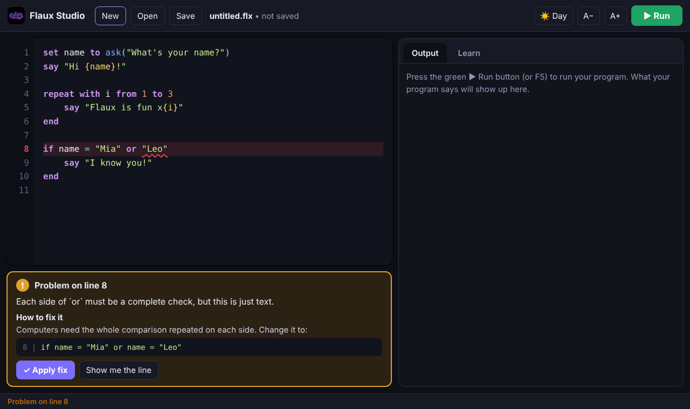
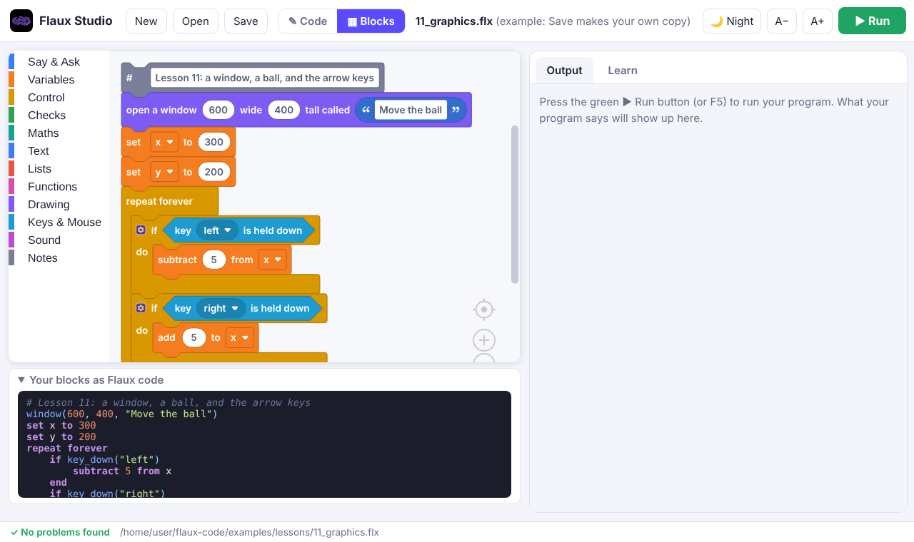
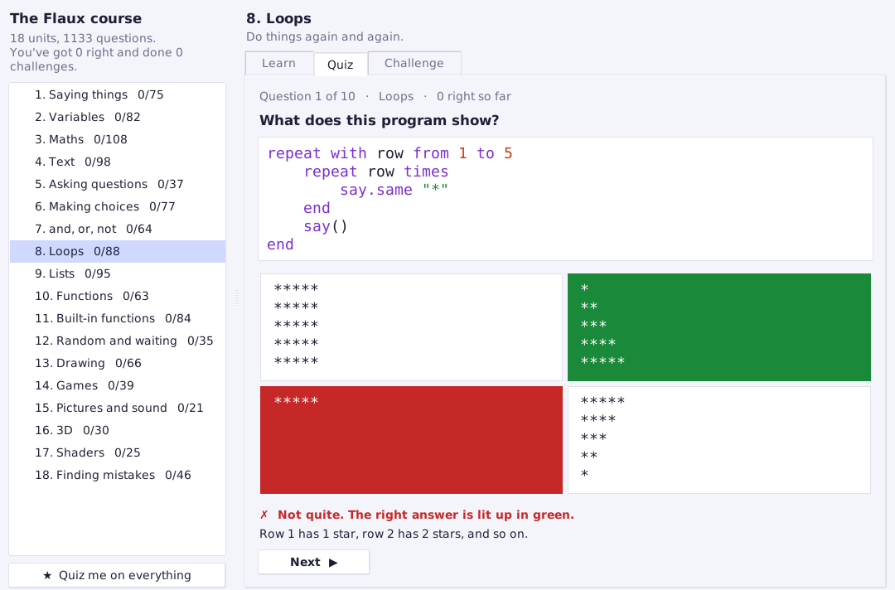
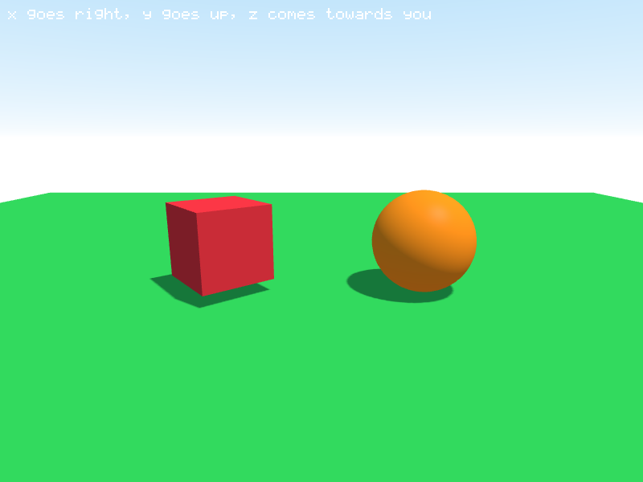
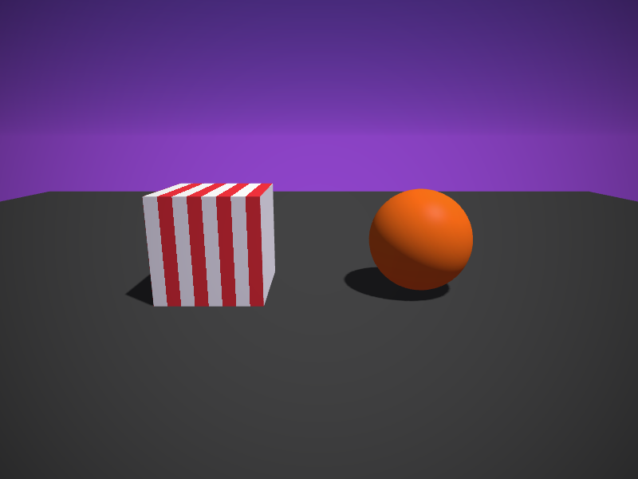
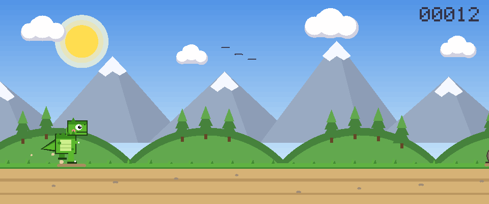
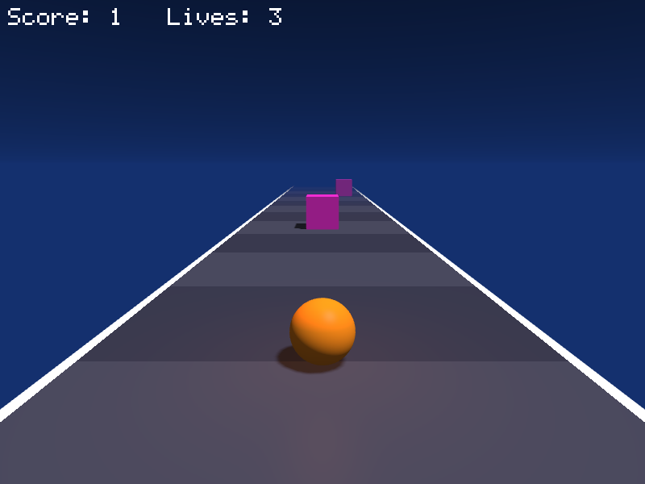
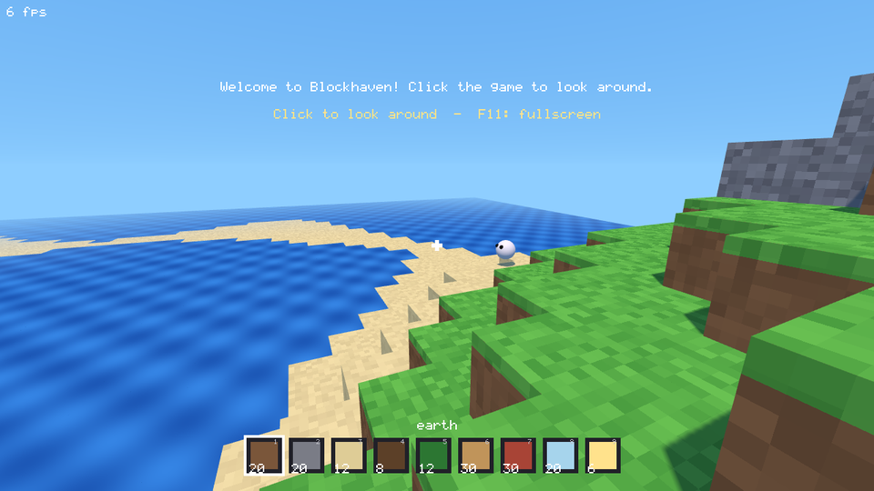
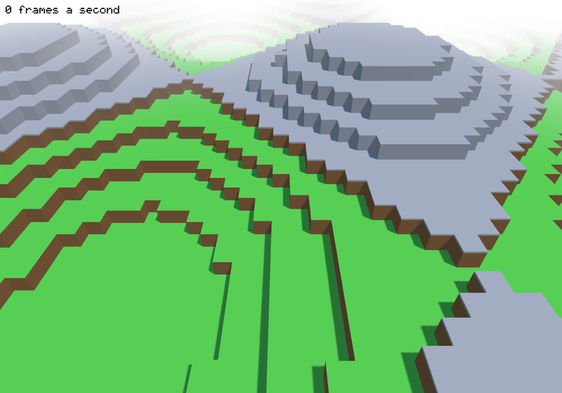

<p align="center"></p>

# Flaux

**Flaux is a coding language that reads like English and runs super fast.
You can make games with it: 2D, 3D with real shadows and shaders, and even
VR.**

```
say "Hello, world!"
```

That's a whole program. No semicolons, no curly brackets, nothing to set up
first. Flaux programs read almost like a sentence, but they run as fast as
C++ and Rust, the fastest languages there are. Type your program in words, or
build it by snapping blocks together.

**[&#11015; Download Flaux for Windows](https://github.com/XOBNVR/Flaux-Code/releases/latest/download/FlauxSetup.exe)**, or
[put Flaux Studio on your own website](#flaux-studio-on-your-website).

---

## Contents

1. [Install Flaux on Windows](#install-flaux-on-windows) (or [put it on your website](#flaux-studio-on-your-website))
2. [Flaux Studio](#flaux-studio) (and [the Flaux course](#the-flaux-course): 18 units, 1,133 quiz questions)
3. [Run your program with a batch file](#run-your-program-with-a-batch-file)
4. [Learn Flaux in 14 lessons](#learn-flaux-in-14-lessons) (13 is 3D, 14 is shaders)
5. [VR and AR](#vr-and-ar)
6. [Game controllers](#game-controllers)
7. [Your first game](#your-first-game)
8. [Example games](#example-games)
9. [Cheat sheet](#cheat-sheet)
10. [When something goes wrong](#when-something-goes-wrong)
11. [Already know another language?](#already-know-another-language)
12. [How fast is it?](#how-fast-is-it)
13. [Mac and Linux](#mac-and-linux)
14. [For people who want to help build Flaux](#for-people-who-want-to-help-build-flaux)

---

## Install Flaux on Windows

**1.** Download the installer:

<p><a href="https://github.com/XOBNVR/Flaux-Code/releases/latest/download/FlauxSetup.exe"><b>&#11015; Download Flaux for Windows (FlauxSetup.exe)</b></a></p>

(Or open the [Releases page](https://github.com/XOBNVR/Flaux-Code/releases) and click
**FlauxSetup.exe** under the newest release.)

**2.** Double-click `FlauxSetup.exe`.

> Windows might show a blue box saying **"Windows protected your PC"**.
> That's because Flaux is new and isn't signed by a big company yet. Click
> **More info**, then **Run anyway**.

**3.** Click **Next** until it's done. Keep all three boxes ticked:

- **Put a Flaux Studio icon on my Desktop**
- **Let me type "flaux" in Command Prompt and in batch files**
- **Open .flx files in Flaux Studio when I double-click them**

**4.** Click **Finish**, and Flaux Studio opens. You're ready to code!

Everything Flaux needs comes inside the installer (Python, a C compiler and
the SDL2 graphics library), so there's nothing else to download. It doesn't
need an administrator, and it works on Windows 10 and 11. To remove it, go
to **Settings, Apps** and uninstall **Flaux**.

### Flaux Studio on your website

Flaux Studio also comes as a website, so people can code in their browser
with nothing to install. It's the same Flaux Studio, with the same lessons,
games, block editor and friendly error messages.

1. Download **[FlauxStudio-web.zip](https://github.com/XOBNVR/Flaux-Code/releases/latest/download/FlauxStudio-web.zip)**.
2. Unzip it, and upload **everything inside** to your website (any web host
   works, and it can go in a folder like `yoursite.com/flaux/`).
3. Open your website's address. That's it.

The zip has a `CLAUDE.md` file that explains every file, how to host it and
how to update it. Visitors download about 10 MB the first time; after that
it opens quickly.

A few things are different in the browser:

- **Your programs are saved in that browser.** Use **Download this program**
  (in **Open**) to keep a copy on your computer, and **Open a .flx file from
  this computer** to bring one in.
- **Games appear above the output.** Click the game so it gets the keys.
  Click **&#9974; Fullscreen** under the game to play on the whole screen
  (**Esc** leaves).
- **Pictures:** click **Pictures** to add your own picture files.
- **Speed:** programs run as JavaScript, which is fine for learning and
  games but much slower than the Windows app for heavy number-crunching.

---

## Flaux Studio

Flaux Studio is where you write and run your programs. Open it from the
**Flaux Studio** icon on your Desktop or in the Start menu. It's a real
Windows app with its own window, made with Tk (the window toolkit that comes
with Python): no web page, no web browser, no Electron. Its buttons and its
Open and Save boxes are Windows' own, and your games open in windows of
their own.



- **Write** your program on the left. Colours show the different parts, and
  **Tab** / **Shift+Tab** move lines right and left.
- **Press the green Run button** (or **F5**). What your program says appears
  on the right. If it asks a question, type your answer in the box at the
  bottom and press **Enter**.
- **Mistakes are underlined while you type.** The yellow box explains what's
  wrong and how to fix it. Click **Apply fix** and Flaux fixes it for you.
- **&#9733; Course** opens the Flaux course: 18 units, each with a lesson, a
  quiz and a challenge, and more than 1,000 quiz questions (see
  [The Flaux course](#the-flaux-course)).
- **Learn** (on the right) has all the lessons, the example games, and
  bits of code you can add to your program with one click.
- **Open** shows your programs, the lessons and the games.
  **Save** keeps your program in your **Documents\Flaux** folder.
- **&#11015; Export** makes a `.zip` of your program that runs without Flaux
  Studio, to share or keep. Unzip it and double-click **`<name>.exe`**: your
  game, in a window of its own, like any other Windows program.
  - In the Windows app the zip (in your **Documents\Flaux** folder) holds
    your real program, as fast as Flaux makes it (plus `SDL2.dll` and its
    pictures for a game: keep them in the same folder). A game that never
    `say`s anything opens just its window, with no black console window
    behind it; a program that says things waits for **Enter** before its
    window closes, so you can read it.
  - On the website the zip has a real `<name>.exe` too: the page makes your
    program into machine code itself, with a small C compiler (TinyCC) that
    runs inside the page, so you don't need the Windows app to make one. It's
    a bit slower than the Windows app's (whose compiler takes more time to
    make programs as fast as they can be), and 3D games made there need a
    graphics card with OpenGL 3.3 (nearly every PC has one).
- **&#127769; Night** switches to dark colours. **A&minus;** and **A+**
  change the text size.

| Key | Does |
|---|---|
| **F5** | run your program |
| **Ctrl+S** | save |
| **Ctrl+O** | open |
| **Ctrl+N** | new program |
| **Ctrl+Z** | undo |
| **Tab** / **Shift+Tab** | move lines right / left |

You can also double-click any `.flx` file to open it in Flaux Studio, or
right-click it and choose **Run with Flaux**.

### Blocks or code

Click **&#9638; Blocks** at the top to build your program from blocks
instead of typing it, in the Windows app and on the website. Drag blocks out of the menus on the left (**Say & Ask**,
**Variables**, **Control**, **Drawing** and more) and snap them together.



Under the blocks, **Your blocks as Flaux code** shows the real Flaux code
your blocks make, so you learn the language as you build. Click
**&#9998; Code** to switch back at any time: it's the same program either way,
saved as a normal `.flx` file, and every lesson and game opens as blocks too.

- **Mistakes** put a red outline on the block (a &#9888; sign on the website), and
  **Apply fix** works here too.
- **Variables:** click **Make a variable** in the Variables menu.
- **Functions:** the Functions menu makes your own blocks.
- **Notes:** your `# notes` become note blocks, and a **code** block (in the
  Notes menu) holds any line of Flaux you want to type yourself.
- **Right-click** a block to copy or delete it (and to add **else** to an
  **if**, or items to a list). Or drag it back onto the menus (the bin, on
  the website) to throw it away.

### The Flaux course

Click **&#9733; Course** at the top (in the Windows app and on the website) for
the whole course: **18 units**, from saying things to 3D and shaders, with
**1,133 quiz questions**.



Each unit has three parts:

- **Learn**: a short explanation with examples, and the lesson program to
  open and run.
- **Quiz**: 10 questions at a time, like "What does this program show?",
  "Which line has the mistake?" or "Which name is allowed?". Click an answer
  and you see straight away if it's right, and why. New questions come first,
  then the ones you got wrong, so you keep practising what you missed.
  **&#9733; Quiz me on everything** mixes questions from every unit.
- **Challenge**: a small program to write. **Start the challenge** puts it in
  the editor; press **Run**, and when your program does it, the challenge is
  done. Stuck? **Show me a way to do it**.

The units list shows how many questions you've got right, with a &#10003; when
you've got most of them and done the challenge. Your progress is kept on
your computer (on the website, in your browser).

Every answer is checked with Flaux itself: each program in a "What does it
show?" question is really run, and each "Which line has the mistake?" is
checked against the line Flaux points at (`python3 -m flauxc.studio.make_course`
makes the course from [`course_units.py`](flauxc/studio/course_units.py) and
[`course_questions.py`](flauxc/studio/course_questions.py)).

---

## Run your program with a batch file

A **batch file** is a tiny file that runs commands for you. Make one, and
you can start your game with a double-click, like any other program.

**1.** Save your program in Flaux Studio. Say you called it `mygame`, so
it's `mygame.flx` in your **Documents\Flaux** folder.

**2.** Open **Notepad** and type these four lines:

```bat
@echo off
cd /d "%~dp0"
flaux mygame.flx
pause
```

**3.** Click **File**, then **Save As**. Go to your **Documents\Flaux**
folder (the same folder as `mygame.flx`). Set **Save as type** to
**All Files (\*.\*)**, type the name `play.bat`, and click **Save**.

**4.** Double-click `play.bat`. Your game starts!

Here's what each line means:

| Line | What it does |
|---|---|
| `@echo off` | hides the commands, so you only see what your program shows |
| `cd /d "%~dp0"` | goes to the folder this batch file is in, so Flaux can find `mygame.flx` next to it |
| `flaux mygame.flx` | runs your program |
| `pause` | waits for you to press a key before the window closes, so you can read what it said |

For a different program, change `mygame.flx` to its name. A ready-made copy
is in [`examples/launchers/play.bat`](examples/launchers/play.bat).

> **It opened in Notepad instead of running?** Windows saved it as
> `play.bat.txt`. In File Explorer, click **View**, turn on **File name
> extensions**, and rename the file to remove `.txt`.
>
> **It says `'flaux' is not recognized`?** Run `FlauxSetup.exe` again and
> keep the box **Let me type "flaux"...** ticked. Then sign out of Windows
> and back in.

**Want to share your game?** Open **Command Prompt** in the folder (type
`cmd` in File Explorer's address bar and press Enter) and type:

```bat
flaux build mygame.flx
```

That makes `mygame.exe`, which runs on any Windows computer, even without
Flaux. If your game has graphics, share the `SDL2.dll` file next to it too.

---

## Learn Flaux in 14 lessons

Every lesson is in Flaux Studio's **Learn** tab (and in
[`examples/lessons/`](examples/lessons/)), so you can open it, run it, and
change it.

### Lesson 1: Say things

`say` shows something on the screen.

```
say "Hello!"
say("Hi there!")
say "I am", 10, "years old"
```

Flaux shows:

```
Hello!
Hi there!
I am 10 years old
```

> Text always goes inside double quotes `" "`. Brackets after `say` are
> optional. Commas let you say several things on one line.

`say.same` says something **without** finishing the line, so the next thing
said goes right after it:

```
repeat 3 times
    say.same "hi "
end
say "!"
```

Flaux shows `hi hi hi !` on one line (first `hi`, then `hi hi`, then
`hi hi hi`). A plain `say` finishes the line.

### Lesson 2: Variables

A **variable** is a box with a name. You put something in it with
`set ... to ...`, and use the name to get it back.

```
set name to "Mia"
set age to 10
say name
say age

set age to 11
say age
```

Flaux shows:

```
Mia
10
11
```

> A box keeps the same *kind* of thing. If `age` holds a number, it can't
> later hold text.

### Lesson 3: Maths

```
say 2 + 3
say 10 - 4
say 3 * 4
say 7 / 2
say 7 // 2
say 7 mod 2
say 2 ^ 3
```

Flaux shows:

```
5
6
12
3.5
3
1
8
```

| Symbol | Means |
|---|---|
| `+` `-` | add, subtract |
| `*` | times |
| `/` | divide |
| `//` | divide and drop the part after the dot |
| `mod` | the remainder after dividing |
| `^` | power (`2 ^ 3` is 2 × 2 × 2) |

Changing a number in a variable is easy:

```
set score to 0
add 10 to score
subtract 3 from score
say score
```

Flaux shows `7`.

### Lesson 4: Text

```
set name to "Mia"
say "Hello, " + name + "!"
say "Hello, {name}!"
say "{name} has {length of name} letters"
say uppercase(name)
```

Flaux shows:

```
Hello, Mia!
Hello, Mia!
Mia has 3 letters
MIA
```

> Put any variable or sum inside `{ }` in your text, and Flaux fills it in.

### Lesson 5: Ask questions

`ask` waits for the person using your program to type something.

```
set name to ask("What's your name?")
say "Nice to meet you, {name}!"

set age to whole(ask("How old are you?"))
say "Next year you'll be {age + 1}."
```

When you run it:

```
What's your name? Mia
Nice to meet you, Mia!
How old are you? 10
Next year you'll be 11.
```

> `ask` always gives back text. `whole(...)` turns text like `"10"` into
> the number `10`, so you can do maths with it.

### Lesson 6: Make choices with `if`

```
set temperature to 30

if temperature > 25
    say "It's hot!"
else if temperature < 10
    say "It's cold!"
else
    say "It's nice."
end
```

Flaux shows `It's hot!`

You can also use words, and join checks with `and`, `or` and `not`:

```
if temperature is more than 20 and temperature is less than 40
    say "Good day for the beach."
end
```

| Check | Words you can use instead |
|---|---|
| `a = b` | `a is b` |
| `a != b` | `a is not b` |
| `a > b` | `a is more than b` |
| `a < b` | `a is less than b` |
| `a >= b` | `a is at least b` |
| `a <= b` | `a is at most b` |

> Every `if` finishes with `end`. Moving the lines inside to the right
> (indenting) isn't required, but it makes your code much easier to read.

### Lesson 7: Repeat things

```
repeat 3 times
    say "Hip hip hooray!"
end

repeat with i from 1 to 5
    say i
end

set lives to 3
repeat while lives > 0
    say "Lives left: {lives}"
    subtract 1 from lives
end
say "Game over!"
```

Flaux shows:

```
Hip hip hooray!
Hip hip hooray!
Hip hip hooray!
1
2
3
4
5
Lives left: 3
Lives left: 2
Lives left: 1
Game over!
```

More kinds of repeat:

| Write | Does |
|---|---|
| `repeat 10 times` | repeats 10 times |
| `repeat with i from 1 to 10` | counts 1, 2, 3 ... 10 |
| `repeat with i from 10 to 1 by -1` | counts down |
| `repeat while lives > 0` | keeps going while the check is true |
| `repeat until done` | keeps going until the check is true |
| `repeat forever` | never stops (use `stop` to get out) |
| `repeat with pet in pets` | goes through each item in a list |

Inside a repeat, `stop` jumps out of it, and `skip` jumps to the next turn.

To watch a loop go slowly, `wait` pauses the program. Put `s` (seconds),
`m` (minutes), `h` (hours) or `d` (days) after the number:

```
repeat with i from 3 to 1 by -1
    say i
    wait 1s
end
say "Lift off!"
```

### Lesson 8: Lists

A **list** holds lots of things in order.

```
set pets to ["cat", "dog"]
add "fish" to pets
say pets
say pets[1]
say length of pets

repeat with pet in pets
    say "I love my {pet}"
end
```

Flaux shows:

```
["cat", "dog", "fish"]
cat
3
I love my cat
I love my dog
I love my fish
```

> The first item is `pets[1]`, the second is `pets[2]`, just like counting
> on your fingers. Start an empty list with `set pets to []`.

### Lesson 9: Make your own instructions (functions)

A **function** is a set of steps with a name. Make it once, use it as many
times as you like.

```
function greet(name)
    say "Hello, {name}!"
end

function double(number)
    return number * 2
end

greet("Mia")
greet("Leo")
say double(21)
```

Flaux shows:

```
Hello, Mia!
Hello, Leo!
42
```

> The names in brackets are the function's **inputs**. `return` gives an
> answer back to whoever used the function.

### Lesson 10: Random

```
set roll to random(1, 6)
say "You rolled a {roll}"

set pick to random(["rock", "paper", "scissors"])
say "I choose {pick}!"
```

Flaux shows something different every time, like:

```
You rolled a 3
I choose scissors!
```

### Lesson 11: Graphics and games

Flaux can open a window and draw in it.

**Draw a picture.** Places in the window are measured in pixels from the
top-left corner. `x` goes to the right and `y` goes **down** (not up like
in maths class).

```
window(400, 300, "My Picture")
clear("sky")
rect(0, 220, 400, 80, "green")          # grass
circle(330, 60, 35, "yellow")           # sun
rect(120, 140, 120, 90, "beige")        # house
line(110, 140, 180, 90, "darkred")      # roof
line(180, 90, 250, 140, "darkred")
line(110, 140, 250, 140, "darkred")
rect(165, 180, 30, 50, "brown")         # door
write("Home sweet home", 20, 20, "navy", 2)
```


**Make it move.** A game is a loop that runs again and again:
change things, draw everything, then `show()` it. `show()` puts your
drawing on the screen and waits a moment, so the loop runs 60 times a
second.

```
window(600, 400, "Move the ball")

set x to 300
set y to 200

repeat forever
    if key_down("left")
        subtract 5 from x
    end
    if key_down("right")
        add 5 to x
    end
    if key_down("up")
        subtract 5 from y
    end
    if key_down("down")
        add 5 to y
    end

    clear("black")
    circle(x, y, 20, "orange")
    write("Use the arrow keys", 10, 10)
    show()
end
```

Run it, and the arrow keys move the ball. Close the window to stop.

**Fullscreen:** press **F11** in a game's window to fill the whole screen
(press it again to go back). In Flaux Studio on the web, click
**&#9974; Fullscreen** under the game. Your game doesn't need to change: it's
made bigger to fit, and the mouse still gives places in your window's own
pixels. In fullscreen (and on sharp screens) games are drawn at the screen's
full resolution, so triangles, circles and lines come out smooth and sharp,
while your program still uses its `window(...)` coordinates. To start a game
fullscreen, put `fullscreen()` after `window(...)`.

**Mouse look:** for a 3D game, `lock_mouse()` hides the pointer and lets the
mouse turn the view: `set turn to turn + mouse_moved_x() * 0.004`. Esc gives
the pointer back, and a click on the game locks it again. See
[Mouse look](docs/LANGUAGE.md#mouse-look).

**Drawing:**

| Write | Draws |
|---|---|
| `window(800, 600, "My Game")` | opens a window 800 wide and 600 tall (do this first) |
| `clear("black")` | fills the whole window with a colour |
| `rect(x, y, width, height, "blue")` | a rectangle (x, y is its top-left corner) |
| `circle(x, y, radius, "red")` | a circle (x, y is its middle) |
| `triangle(x1, y1, x2, y2, x3, y3, "orange")` | a triangle with three corners |
| `line(x1, y1, x2, y2, "white", 3)` | a line, 3 pixels thick (leave out the 3 for a thin line) |
| `dot(x, y, "white")` | one pixel |
| `write("Score: {score}", x, y, "white", 3)` | text, size 3 (leave out the size for size 2) |
| `show()` | shows the drawing and waits for the next frame |

**Keyboard, mouse and sound:**

| Write | Means |
|---|---|
| `key_down("left")` | true while the key is held down |
| `key_pressed("space")` | true only at the moment the key goes down (good for jumping) |
| `mouse_x()`, `mouse_y()` | where the mouse is |
| `mouse_down()` | true while the mouse button is held |
| `mouse_clicked()` | true only at the moment of a click |
| `mouse_moved_x()`, `mouse_moved_y()` | how far the mouse moved since the last frame, in screen pixels (the same however big the game is shown) |
| `lock_mouse()`, `unlock_mouse()` | hides the pointer so the mouse can turn a 3D view (Esc gives it back) |
| `mouse_locked()` | true while the mouse is locked |
| `beep(440, 0.2)` | plays a beep: pitch 440 for 0.2 seconds |

**Colours:** `"black"`, `"white"`, `"gray"`, `"red"`, `"orange"`,
`"yellow"`, `"gold"`, `"green"`, `"lime"`, `"blue"`, `"navy"`, `"sky"`,
`"cyan"`, `"teal"`, `"purple"`, `"violet"`, `"pink"`, `"magenta"`,
`"brown"`, `"beige"`, plus `"dark ..."` and `"light ..."` versions of some of
them (like `"dark green"`). Mix your own with `rgb(255, 136, 0)`, or use a
code like `"#ff8800"`.

**Handy helpers:** `distance(x1, y1, x2, y2)` tells you how far apart two
points are, which is great for checking if two things touch.
`text_width("GAME OVER", 5)` tells you how wide some text is, to help
centre it.

### Lesson 12: Pictures

Games look better with pictures (game makers call them **sprites**). Put a
picture file, like `ship.png`, in the **same folder** as your program,
then draw it with `image`:

```
window(800, 600, "Pictures")

set x to 400

repeat forever
    if key_down("left")
        subtract 6 from x
    end
    if key_down("right")
        add 6 to x
    end

    clear("navy")
    image("ship.png", x - 32, 480, 64, 64)
    write("Arrow keys move the ship", 10, 10)
    show()
end
```

| Write | Draws |
|---|---|
| `image("ship.png", x, y)` | the picture at its own size, with its top-left corner at x, y |
| `image("ship.png", x, y, 64, 64)` | the picture stretched to 64 by 64 pixels |
| `image("ship.png", x, y, -64, 64)` | the same, but flipped (a minus width flips it) |
| `image("ship.png", x, y, 64, 64, 90)` | the same, turned 90 degrees |
| `image_width("ship.png")` | how wide the picture really is |

Flaux can use `.png`, `.jpg`, `.bmp` and `.gif` pictures. PNG pictures can
have see-through parts. You can draw your own in **Paint** (or a free
pixel-art website), and save them as PNG.

> **Tip:** small pixel-art pictures (like 16 by 16) look great made bigger,
> because Flaux keeps the pixels sharp instead of blurry.

### Lesson 13: 3D



In 3D, every place has three numbers: **x** goes right, **y** goes **up**,
and **z** comes **towards you**. The graphics card does the drawing, with
real light, shadows and smooth edges.

```
window(800, 600, "My first 3D world")

set angle to 0

repeat forever
    sky("sky", "white")                # blue at the top, white at the horizon
    camera(0, 3, 8, 0, 1, 0)           # stand at 0, 3, 8 and look at 0, 1, 0

    plane(0, 0, 0, 30, 30, "green")    # a flat green floor

    turn(0, angle, 0)                  # turn the next shapes...
    cube(-2, 1, 0, 1.5, "red")         # ...like this cube
    turn(0, 0, 0)                      # (stop turning)

    ball(2, 1, 0, 1, "orange")
    add 1 to angle
    show()
end
```

| Write | Draws |
|---|---|
| `cube(x, y, z, size, "red")` | a cube, with its middle at x, y, z |
| `box(x, y, z, width, height, depth, "brown")` | a box (a stretched cube) |
| `ball(x, y, z, radius, "orange")` | a ball |
| `cylinder(x, y, z, radius, height, "gray")` | a cylinder, standing up |
| `cone(x, y, z, radius, height, "green")` | a cone, point up (great for trees) |
| `plane(x, y, z, width, depth, "green")` | a flat floor |
| `model("tree.obj", x, y, z, size)` | a 3D model file, with its own colours |

And to set the scene:

| Write | Does |
|---|---|
| `camera(x, y, z, look_x, look_y, look_z)` | where you see from, and the point you look at |
| `sky("blue")` or `sky("blue", "white")` | the sky's colour (top, then horizon) |
| `sun(1, 2, 1)` | the direction sunlight comes from (`sun(0, 0, 0)` for night) |
| `light(x, y, z, "yellow")` | a lamp, for this frame |
| `fog(50)` | things fade into the sky until 50 steps away |
| `turn(x, y, z)` | turns the shapes drawn after it (in degrees) |

**Pictures on shapes:** use a picture's name instead of a colour:
`cube(0, 0, 0, 1, "crate.png")`. On a `plane`, the picture repeats every
step, so a small grass picture covers a whole field.

**Models:** make them in Blender (or download free ones, like Kenney's) and
save them as `.obj`, next to your program. Their `.mtl` colours come too.

**2D on top:** `write`, `rect`, `image` and the other 2D drawing still work
in a 3D window, drawn on top, so scores and messages are easy.

> **Fast with thousands of things:** Flaux draws all the cubes (or balls)
> of the same kind together, in one go on the graphics card. The block world
> example draws 6,400 blocks every frame.

### Lesson 14: Shaders



A **shader** is a little program that runs on the graphics card, once for
every pixel, millions of times a second. In Flaux you write shaders in Flaux:

```
shader stripes
    if floor(x * 4) mod 2 = 0
        return "white"
    end
    return "red"
end

window(800, 600)
repeat forever
    sky("navy")
    cube(0, 1, 0, 2, stripes)       # a shader goes where a colour would
    show()
end
```

A shader works out a colour and gives it back with `return`. It already
knows some numbers:

| On a shape | |
|---|---|
| `x`, `y`, `z` | the point being painted, in the world |
| `u`, `v` | where on the face (0 to 1 across) |
| `nx`, `ny`, `nz` | which way the face points (`ny` is 1 on top) |
| `time` | seconds since the window opened, for moving patterns |

Light, shadows and fog are added afterwards, so painted shapes still look 3D.

**Screen effects** put the whole window through a shader with `effect(...)`.
There, `x` and `y` are the pixel, `red`, `green` and `blue` are its colour
(0 to 255), and `red_at(x, y)` (and green, blue) look at other pixels:

```
shader dark_corners
    set d to distance(x, y, width / 2, height / 2) / width
    set light to 1 - d * d
    return rgb(red * light, green * light, blue * light)
end

...
effect(dark_corners)      # once a frame, before show()
```

**Numbers from your program:** a shader can use your variables too. If it
uses a name it doesn't set itself, like `health`, it gets the `health` from
where it's used: `cube(0, 0, 0, 1, glow)` passes in `health` from that line.

A shader can use numbers, true/false, colours, `if`, `repeat` and maths
(`sin`, `cos`, `sqrt`, `floor`, `min`, `max`, `distance`, `abs`, ...). It
can't use lists, text or `say`, because the graphics card can't. If you try,
Flaux explains why and what to do instead.

---

## VR and AR


Your 3D programs work in VR headsets too.

- **In Flaux Studio on the web** (on a Meta Quest's browser, an Android
  phone, or a PC with a headset), 3D programs get an **Enter VR** button
  (and **Enter AR** on devices that can show the room around you).
- **In the Windows app**, programs that use `in_vr()` or your hands open in
  the headset by themselves, if one is connected (SteamVR, Meta Quest Link
  or Windows Mixed Reality).

`camera(...)` becomes where you stand, and you look around by moving your
head. Your hands:

| Write | Gives back |
|---|---|
| `in_vr()` | true while the program is in a headset |
| `hand_x("right")`, `hand_y("right")`, `hand_z("right")` | where your right hand is (or `"left"`) |
| `button_down("rt")` | the right trigger (`"lt"` is the left; the grips are `"rb"` and `"lb"`) |
| `stick_x("left")`, `stick_y("left")` | the controller's stick |

Try [`examples/3d/vr_garden.flx`](examples/3d/vr_garden.flx): hold the
trigger to grow flowers where your hand is.

---

## Game controllers

Plug in an Xbox, PlayStation or Switch controller, and your games can use it:

```
if button_down("a")
    say "jump!"
end
add stick_x() * 5 to x        # the left stick: -1 (left) to 1 (right)
```

| Write | Gives back |
|---|---|
| `button_down("a")` | true while the button is held |
| `button_pressed("start")` | true only on the frame it goes down |
| `stick_x()`, `stick_y()` | the left stick, from -1 to 1 (up is positive) |
| `stick_x("right")`, `stick_y("right")` | the right stick |

Buttons: `"a"`, `"b"`, `"x"`, `"y"`, `"start"`, `"back"`, `"lb"`, `"rb"`
(the bumpers), `"lt"`, `"rt"` (the triggers), `"l3"`, `"r3"` (pressing a
stick) and `"up"`, `"down"`, `"left"`, `"right"` (the D-pad). VR
controllers use the same names, and on phones and tablets a finger works
like the mouse.

---

## Your first game

You now know enough to build a real game. Save this as `guess.flx` and run
it with `./flaux guess.flx`:

```
set secret to random(1, 100)
set tries to 0
say "I'm thinking of a number between 1 and 100."

repeat forever
    set answer to ask("Your guess:")
    if not is_number(answer)
        say "That's not a number. Try again!"
        skip
    end
    set guess to whole(answer)
    add 1 to tries
    if guess < secret
        say "Higher!"
    else if guess > secret
        say "Lower!"
    else
        say "You got it in {tries} tries!"
        stop
    end
end
```

More programs to try are in [`examples/`](examples/).

---

## Example games


Open them from the **Learn** tab in Flaux Studio, or run them from a
command line:

| Game | Run it with |
|---|---|
| **Star Catcher**: move the basket with the arrow keys and catch the falling stars | `./flaux examples/games/star_catcher.flx` |
| **Bounce**: a bouncing ball with gravity and sound | `./flaux examples/games/bounce.flx` |
| **Doodle**: draw with the mouse | `./flaux examples/games/doodle.flx` |
| **Picture**: a drawing with no loop at all | `./flaux examples/games/picture.flx` |
| **Space Dodge**: steer a spaceship past falling rocks (uses pictures) | `./flaux examples/games/space_dodge.flx` |
| **Dino Dash**: a dinosaur runs by itself; jump boulders, stumps and logs, duck the bugs, grab gems, from day to night | `./flaux examples/games/dino_dash.flx` |



And in 3D:



| 3D | Run it with |
|---|---|
| **Blockhaven**: a first-person island of blocks: walk, jump, swim, dig and build, with day and night (mouse, keys or a controller; F11 for fullscreen) | `./flaux examples/3d/blockhaven.flx` |
| **3D Runner**: dodge the blocks on a shader-painted road (keys or a controller) | `./flaux examples/3d/runner.flx` |
| **Block world**: fly over 6,400 blocks with grass, dirt and stone | `./flaux examples/3d/block_world.flx` |
| **VR garden**: grow flowers with your hands in a VR headset | `./flaux examples/3d/vr_garden.flx` |
| **Model viewer**: a rocket loaded from a 3D model file | `./flaux examples/3d/model_viewer.flx` |
| **Ocean**: an endless sea drawn by one shader: waves, sky reflections, sun glitter and foam, at four times of day | `./flaux examples/3d/ocean.flx` |






Open them up, read them, and change things. Make the stars fall faster,
change the colours, add a second basket. That's the best way to learn.

---

## Cheat sheet

| I want to... | Write |
|---|---|
| show something | `say "hi"` or `say("hi")` |
| make a variable | `set score to 0` |
| change a number | `add 1 to score` / `subtract 1 from score` |
| put a value in text | `say "Score: {score}"` |
| ask a question | `set name to ask("Name?")` |
| turn text into a number | `whole("42")` or `number("3.5")` |
| check something | `if score > 10` ... `end` |
| choose between things | `if` ... `else if` ... `else` ... `end` |
| repeat | `repeat 5 times` ... `end` |
| count | `repeat with i from 1 to 10` ... `end` |
| make a list | `set pets to ["cat", "dog"]` |
| add to a list | `add "fish" to pets` |
| get an item | `pets[1]` |
| count items | `length of pets` |
| make a function | `function name(input)` ... `end` |
| give back an answer | `return answer` |
| roll a dice | `random(1, 6)` |
| pause for a while | `wait 1s`, `wait 0.5s`, `wait 2m`, `wait delay seconds` |
| leave a note | `# anything after a hash is ignored` |
| open a window | `window(800, 600, "My Game")` |
| draw shapes | `rect(...)`, `circle(...)`, `triangle(...)`, `line(...)` |
| draw text | `write("Hi", 10, 10, "white", 3)` |
| make a game loop | `repeat forever` ... `show()` ... `end` |
| check a key | `if key_down("left")` |
| draw a picture | `image("ship.png", x, y, 64, 64)` |
| draw in 3D | `cube(x, y, z, 1, "red")`, `ball(...)`, `plane(...)`, `model(...)` |
| set up a 3D scene | `camera(...)`, `sky(...)`, `sun(...)`, `light(...)`, `fog(...)` |
| paint with a shader | `shader name` ... `return colour` ... `end`, then `cube(0, 0, 0, 1, name)` |
| use a game controller | `button_down("a")`, `stick_x()` |
| check for VR | `if in_vr()` ... `hand_x("right")` |

Built-in helpers: `ask`, `random`, `length`, `contains`, `text`, `number`,
`whole`, `is_number`, `round`, `floor`, `ceil`, `abs`, `min`, `max`, `sqrt`,
`uppercase`, `lowercase`, `sin`, `cos`, `tan`, `log`, `clock`, `distance`, `rgb`.
Graphics: `window`, `clear`, `rect`, `circle`, `triangle`, `line`, `dot`,
`write`, `show`, `key_down`, `key_pressed`, `mouse_x`, `mouse_y`,
`mouse_down`, `mouse_clicked`, `beep`, `text_width`, `screenshot`, `image`,
`image_width`, `image_height`, `fps`, `seconds`, `fullscreen`,
`mouse_moved_x`, `mouse_moved_y`, `lock_mouse`, `unlock_mouse`, `mouse_locked`,
`button_down`, `button_pressed`, `stick_x`, `stick_y`.
3D: `camera`, `sky`, `sun`, `light`, `fog`, `turn`, `cube`, `box`, `ball`,
`cylinder`, `cone`, `plane`, `model`, `effect`, `in_vr`, `hand_x`,
`hand_y`, `hand_z`.
Every one is explained in the [full guide](docs/LANGUAGE.md).

---

## When something goes wrong

Everyone makes mistakes when coding. Flaux doesn't just tell you something
is wrong. It **teaches you how to fix it**, and usually shows your line
already fixed:

```
Problem in pets.flx, line 2:

  2 | if pet = "cat" or "dog"
    |                   ^^^^^

Each side of `or` must be a complete check, but this is just text.

How to fix it:
  Computers need the whole comparison repeated on each side. Change it to:

  2 | if pet = "cat" or pet = "dog"
```

It even helps when your program is running:

```
Problem while running pets.flx, line 3:

  3 | say pets[5]

You asked for item number 5, but there are only 3.

How to fix it:
  Items are numbered from 1 up to `length of` the list. ...
```

---

## Already know another language?

Flaux spots habits from other languages and shows you the Flaux way. Here's
a quick translation:

| Python / JavaScript / C# | Flaux |
|---|---|
| `print("hi")` / `console.log("hi")` | `say "hi"` |
| `x = 5` / `let x = 5` / `var x = 5;` | `set x to 5` |
| `x += 1` / `x++` | `add 1 to x` |
| `if x == 5:` / `if (x == 5) {` | `if x = 5` ... `end` |
| `elif` / `else if` | `else if` |
| `for i in range(1, 11):` | `repeat with i from 1 to 10` |
| `for pet in pets:` | `repeat with pet in pets` |
| `while x < 5:` | `repeat while x < 5` |
| `break` / `continue` | `stop` / `skip` |
| `def f(x):` / `function f(x) {` | `function f(x)` ... `end` |
| `&&` `\|\|` `!` | `and` `or` `not` |
| `len(pets)` / `pets.length` | `length of pets` |
| `pets.append(x)` / `pets.push(x)` | `add x to pets` |
| `pets[0]` (first item) | `pets[1]` (first item) |
| `input("Name?")` | `ask("Name?")` |
| `str(5)` / `int("5")` | `text(5)` / `whole("5")` |

---

## How fast is it?

We raced the same programs in Flaux, Rust, C++, C# and Python. Smaller is
faster:

| Test | Flaux | Rust | C++ | C# | Python |
|---|---|---|---|---|---|
| Lots of function calls | **0.16s** | 0.31s | 0.16s | 0.46s | 10.73s |
| Finding prime numbers | **0.33s** | 0.38s | 0.37s | 0.40s | 11.48s |
| Whole-number maths | 0.58s | **0.45s** | 0.71s | 0.90s | 44.42s |
| Decimal maths | **0.20s** | 0.21s | 0.22s | 0.25s | 18.78s |
| Building a big list | **0.15s** | 0.17s | 0.31s | 0.48s | 5.55s |

Flaux beat Rust on 4 of the 5 tests (Rust won the whole-number maths one),
matched or beat C++ on every test, beat C# on every test, and was 34 to 94
times faster than Python. Every language was built with its normal
fast settings (Rust like `cargo build --release`). ([Details, and how to run
the race yourself](benchmarks/RESULTS.md).)

**How can something so easy be so fast?** Flaux figures out what kind of
value is in every variable *before* your program runs, then turns your
program into machine code, the computer's own language. Easy languages like
Python work things out while the program is running, which is much slower.

---

## Mac and Linux

Flaux works on Mac and Linux too. You need **Python 3**, a **C compiler**
(gcc or clang) and, for graphics, **SDL2**:

```bash
sudo apt install python3 gcc libsdl2-dev      # Ubuntu, Debian
brew install sdl2                             # Mac (with Homebrew), after: xcode-select --install
```

Then download Flaux and open Flaux Studio:

```bash
git clone https://github.com/XOBNVR/Flaux-Code.git
cd Flaux-Code
./flaux studio
```

Or run a program straight from the terminal:

```bash
./flaux examples/hello.flx
```

To start a program with a double-click, make a launcher file. On a Mac,
save this in TextEdit (**Format, Make Plain Text**) as `play.command`, run
`chmod +x play.command` once in Terminal, then double-click it:

```bash
#!/bin/bash
cd ~/Flaux-Code
./flaux examples/games/star_catcher.flx
```

On Linux, do the same with a file called `play.sh`. Ready-made copies are
in [`examples/launchers/`](examples/launchers/).

---

## For people who want to help build Flaux

Flaux is written in Python. It turns `.flx` files into C code, and a C
compiler turns that into a program.

```
your .flx file → lexer → parser → type checker → C code → gcc/clang → fast program
```

| File | Job |
|---|---|
| [`flauxc/lexer.py`](flauxc/lexer.py) | splits code into words and symbols |
| [`flauxc/parser.py`](flauxc/parser.py) | understands the grammar, catches typing mistakes |
| [`flauxc/compiler.py`](flauxc/compiler.py) | works out every type and writes C code |
| [`flauxc/runtime.h`](flauxc/runtime.h) | the small C toolkit every program uses |
| [`flauxc/graphics.h`](flauxc/graphics.h) | windows, drawing, keyboard, mouse and sound (uses SDL2) |
| [`flauxc/font.py`](flauxc/font.py) | the 5x7 pixel font used to write text in windows |
| [`flauxc/errors.py`](flauxc/errors.py) | turns problems into friendly, teaching messages |
| [`flauxc/cli.py`](flauxc/cli.py) | the `flaux` command |
| [`flauxc/studio/`](flauxc/studio/) | Flaux Studio: a tiny local web server and the editor page |
| [`flauxc/jsgen.py`](flauxc/jsgen.py) | the second backend: turns Flaux into JavaScript for the web version |
| [`flauxc/web/`](flauxc/web/) | Flaux Studio on the web: the JavaScript runtime (`fx.js`), the page's helper (`web.js`), Python's side (`web_api.py`), the site builder (`build.py`) and the C compiler Export uses in the page (`build_tcc.py`: TinyCC as WebAssembly) |
| [`flauxc/studio/blocks.py`](flauxc/studio/blocks.py), [`blocks.js`](flauxc/studio/blocks.js) | the block editor: code to blocks, and blocks to code (built on [Blockly](https://developers.google.com/blockly)) |
| [`installer/`](installer/) | the Windows installer (Inno Setup), `flaux.exe`, and its build scripts |
| [`flauxc/studio/app.py`](flauxc/studio/app.py) | Flaux Studio, the desktop app (Tk); `installer/studio_launcher.c` is `FlauxStudio.exe`, which opens it |
| [`assets/`](assets/) | the Flaux icon, and the script that makes every size of it |

Useful commands:

```bash
./flaux check game.flx          # look for mistakes without running
./flaux build game.flx          # make a program you can share
./flaux c game.flx              # see the C code Flaux makes
python3 tests/run_tests.py      # run all the tests
python3 tests/blocks_roundtrip.py   # every program through the block editor and back
python3 tests/js_tests.py       # every test program on the web version, with Node
python3 -m flauxc.web.build site --pyodide <folder>   # build Flaux Studio for the web
python3 benchmarks/run.py       # race Flaux against C++, C# and Python
./flaux studio                  # open Flaux Studio
```

Every change pushed to GitHub is tested on Linux and on Windows
([`.github/workflows/build.yml`](.github/workflows/build.yml)). The Windows
run also builds `FlauxSetup.exe`, installs it, and uses it the way a
beginner would: Flaux Studio, the `flaux` command, a batch file exactly like
the one above, a graphics game, and uninstalling. When all of that passes
on `main`, the build publishes that exact installer as the latest GitHub
release, which is what the download button gives you.

### Coming next

- [ ] Freeing memory that programs no longer need
- [ ] Functions that can see variables made outside them
- [ ] Removing items from lists, splitting and joining text
- [ ] Grouping values together (like a player with a name and a score)
- [x] Graphics and sound for making games
- [x] Pictures from files (sprites) for games
- [x] A Windows installer and a beginner code editor (Flaux Studio)
- [x] A drag-and-drop block editor that writes Flaux for you
- [x] Flaux Studio as a website, for your own web host
- [x] 3D on the graphics card: shapes, models, lights, shadows, fog and sky
- [x] Shaders written in Flaux, for shapes and the whole screen
- [x] VR and AR headsets (WebXR on the web, OpenXR on Windows) and game controllers
