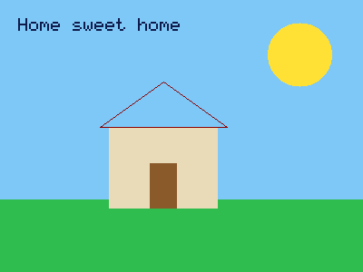
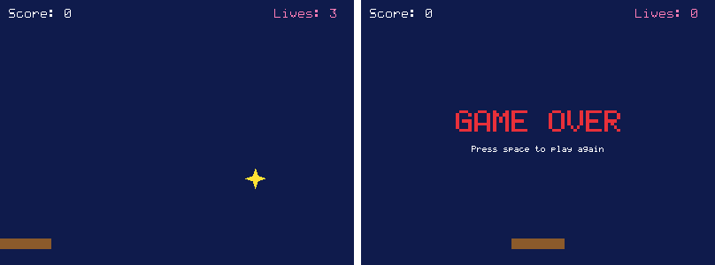

# Flaux

**Flaux is a coding language that reads like English and runs super fast.
You can even make games with it.**

```
say "Hello, world!"
```

That's a whole program. No semicolons, no curly brackets, nothing to set up
first. Flaux programs read almost like a sentence, but they run as fast as
C++, one of the fastest languages there is.

---

## Contents

1. [Get Flaux running](#get-flaux-running)
2. [Run your program with a double-click](#run-your-program-with-a-double-click)
3. [Learn Flaux in 11 lessons](#learn-flaux-in-11-lessons)
4. [Your first game](#your-first-game)
5. [Example games](#example-games)
6. [Cheat sheet](#cheat-sheet)
7. [When something goes wrong](#when-something-goes-wrong)
8. [Already know another language?](#already-know-another-language)
9. [How fast is it?](#how-fast-is-it)
10. [For people who want to help build Flaux](#for-people-who-want-to-help-build-flaux)

---

## Get Flaux running

You need two free tools on your computer: **Python 3** and a **C compiler**
(gcc or clang). Most Linux and Mac computers already have them. On Windows,
use [WSL](https://learn.microsoft.com/windows/wsl/install).

**Step 1.** Download Flaux:

```bash
git clone https://github.com/XOBNVR/Flaux-Code.git
cd Flaux-Code
```

**Step 2.** Run your first program:

```bash
./flaux examples/hello.flx
```

**Step 3.** Make your own! Create a file called `me.flx`, type this in it,
and save it:

```
say "My name is Sam"
```

Then run it:

```bash
./flaux me.flx
```

That's it. You're coding.

**For graphics and games** (Lesson 11), also install the free SDL2 library,
just once:

```bash
sudo apt install libsdl2-dev      # Linux and WSL
brew install sdl2                 # Mac (with Homebrew)
```

---

## Run your program with a double-click

Typing `./flaux mygame.flx` every time gets boring. Instead, you can make a
tiny **launcher file** that types the command for you. Then you start your
game by double-clicking it, just like any other program.

On Windows this is called a **batch file** (it ends in `.bat`). On a Mac
it's a `.command` file, and on Linux a `.sh` file. Ready-made copies of all
three are in [`examples/launchers/`](examples/launchers/).

### Windows: make a batch file

These steps assume you followed [Get Flaux running](#get-flaux-running) in
WSL, so the `Flaux-Code` folder is in your Linux home folder.

**1.** Open **Notepad**.

**2.** Type these three lines:

```bat
@echo off
wsl bash -lc "cd ~/Flaux-Code && ./flaux examples/games/star_catcher.flx"
pause
```

**3.** Click **File**, then **Save As**. Set **Save as type** to
**All Files (\*.\*)**, type the name `play.bat`, and save it on your
**Desktop**.

**4.** Double-click `play.bat` on your Desktop. Your game starts!

Here's what each part means:

| Part | What it does |
|---|---|
| `@echo off` | hides the commands, so you only see what your program shows |
| `wsl` | runs the rest in Linux (WSL), where Flaux lives |
| `bash -lc "..."` | runs the commands inside the quotes |
| `cd ~/Flaux-Code` | goes into the Flaux-Code folder |
| `&&` | "and then, if that worked..." |
| `./flaux examples/games/star_catcher.flx` | runs the program |
| `pause` | waits for you to press a key before the black window closes, so you can read any messages |

**To run your own program,** change `examples/games/star_catcher.flx` to
your file's name. For example, if you saved `me.flx` in the Flaux-Code
folder:

```bat
@echo off
wsl bash -lc "cd ~/Flaux-Code && ./flaux me.flx"
pause
```

> **It opened in Notepad instead of running?** Windows saved it as
> `play.bat.txt`. In File Explorer, click **View**, turn on **File name
> extensions**, and rename the file to remove `.txt`.
>
> **Graphics need Windows 11** (it can show windows from WSL by itself).
> Text programs work on Windows 10 too.

### Mac: make a `.command` file

**1.** Open **TextEdit**. Click **Format**, then **Make Plain Text**.

**2.** Type:

```bash
#!/bin/bash
cd ~/Flaux-Code
./flaux examples/games/star_catcher.flx
```

**3.** Save it on your Desktop as `play.command`.

**4.** Just once, open **Terminal** and type this, so your Mac knows the
file is allowed to run:

```bash
chmod +x ~/Desktop/play.command
```

**5.** Double-click `play.command`. (The first time, your Mac may say it's
from an unknown developer. Right-click it, choose **Open**, then **Open**
again.)

| Line | What it does |
|---|---|
| `#!/bin/bash` | says "these are Terminal commands" |
| `cd ~/Flaux-Code` | goes into the Flaux-Code folder |
| `./flaux examples/games/star_catcher.flx` | runs the program |

### Linux: make a `.sh` file

Make a file called `play.sh` with the same three lines as the Mac one,
then make it runnable, just once:

```bash
chmod +x play.sh
```

Now run it with `./play.sh`, or double-click it in your file manager (if it
asks, choose **Run**).

---

## Learn Flaux in 11 lessons

Every lesson is also a file in [`examples/lessons/`](examples/lessons/), so
you can run it yourself and change it. For example:

```bash
./flaux examples/lessons/01_say.flx
```

### Lesson 1: Say things

`say` shows something on the screen.

```
say "Hello!"
say("Hi there!")
say "I am", 10, "years old"
```

Flaux shows:

```
Hello!
Hi there!
I am 10 years old
```

> Text always goes inside double quotes `" "`. Brackets after `say` are
> optional. Commas let you say several things on one line.

### Lesson 2: Variables

A **variable** is a box with a name. You put something in it with
`set ... to ...`, and use the name to get it back.

```
set name to "Mia"
set age to 10
say name
say age

set age to 11
say age
```

Flaux shows:

```
Mia
10
11
```

> A box keeps the same *kind* of thing. If `age` holds a number, it can't
> later hold text.

### Lesson 3: Maths

```
say 2 + 3
say 10 - 4
say 3 * 4
say 7 / 2
say 7 // 2
say 7 mod 2
say 2 ^ 3
```

Flaux shows:

```
5
6
12
3.5
3
1
8
```

| Symbol | Means |
|---|---|
| `+` `-` | add, subtract |
| `*` | times |
| `/` | divide |
| `//` | divide and drop the part after the dot |
| `mod` | the remainder after dividing |
| `^` | power (`2 ^ 3` is 2 × 2 × 2) |

Changing a number in a variable is easy:

```
set score to 0
add 10 to score
subtract 3 from score
say score
```

Flaux shows `7`.

### Lesson 4: Text

```
set name to "Mia"
say "Hello, " + name + "!"
say "Hello, {name}!"
say "{name} has {length of name} letters"
say uppercase(name)
```

Flaux shows:

```
Hello, Mia!
Hello, Mia!
Mia has 3 letters
MIA
```

> Put any variable or sum inside `{ }` in your text, and Flaux fills it in.

### Lesson 5: Ask questions

`ask` waits for the person using your program to type something.

```
set name to ask("What's your name?")
say "Nice to meet you, {name}!"

set age to whole(ask("How old are you?"))
say "Next year you'll be {age + 1}."
```

When you run it:

```
What's your name? Mia
Nice to meet you, Mia!
How old are you? 10
Next year you'll be 11.
```

> `ask` always gives back text. `whole(...)` turns text like `"10"` into
> the number `10`, so you can do maths with it.

### Lesson 6: Make choices with `if`

```
set temperature to 30

if temperature > 25
    say "It's hot!"
else if temperature < 10
    say "It's cold!"
else
    say "It's nice."
end
```

Flaux shows `It's hot!`

You can also use words, and join checks with `and`, `or` and `not`:

```
if temperature is more than 20 and temperature is less than 40
    say "Good day for the beach."
end
```

| Check | Words you can use instead |
|---|---|
| `a = b` | `a is b` |
| `a != b` | `a is not b` |
| `a > b` | `a is more than b` |
| `a < b` | `a is less than b` |
| `a >= b` | `a is at least b` |
| `a <= b` | `a is at most b` |

> Every `if` finishes with `end`. Moving the lines inside to the right
> (indenting) isn't required, but it makes your code much easier to read.

### Lesson 7: Repeat things

```
repeat 3 times
    say "Hip hip hooray!"
end

repeat with i from 1 to 5
    say i
end

set lives to 3
repeat while lives > 0
    say "Lives left: {lives}"
    subtract 1 from lives
end
say "Game over!"
```

Flaux shows:

```
Hip hip hooray!
Hip hip hooray!
Hip hip hooray!
1
2
3
4
5
Lives left: 3
Lives left: 2
Lives left: 1
Game over!
```

More kinds of repeat:

| Write | Does |
|---|---|
| `repeat 10 times` | repeats 10 times |
| `repeat with i from 1 to 10` | counts 1, 2, 3 ... 10 |
| `repeat with i from 10 to 1 by -1` | counts down |
| `repeat while lives > 0` | keeps going while the check is true |
| `repeat until done` | keeps going until the check is true |
| `repeat forever` | never stops (use `stop` to get out) |
| `repeat with pet in pets` | goes through each item in a list |

Inside a repeat, `stop` jumps out of it, and `skip` jumps to the next turn.

### Lesson 8: Lists

A **list** holds lots of things in order.

```
set pets to ["cat", "dog"]
add "fish" to pets
say pets
say pets[1]
say length of pets

repeat with pet in pets
    say "I love my {pet}"
end
```

Flaux shows:

```
["cat", "dog", "fish"]
cat
3
I love my cat
I love my dog
I love my fish
```

> The first item is `pets[1]`, the second is `pets[2]`, just like counting
> on your fingers. Start an empty list with `set pets to []`.

### Lesson 9: Make your own instructions (functions)

A **function** is a set of steps with a name. Make it once, use it as many
times as you like.

```
function greet(name)
    say "Hello, {name}!"
end

function double(number)
    return number * 2
end

greet("Mia")
greet("Leo")
say double(21)
```

Flaux shows:

```
Hello, Mia!
Hello, Leo!
42
```

> The names in brackets are the function's **inputs**. `return` gives an
> answer back to whoever used the function.

### Lesson 10: Random

```
set roll to random(1, 6)
say "You rolled a {roll}"

set pick to random(["rock", "paper", "scissors"])
say "I choose {pick}!"
```

Flaux shows something different every time, like:

```
You rolled a 3
I choose scissors!
```

### Lesson 11: Graphics and games

Flaux can open a window and draw in it. (You need SDL2 installed for this,
see [Get Flaux running](#get-flaux-running).)

**Draw a picture.** Places in the window are measured in pixels from the
top-left corner. `x` goes to the right and `y` goes **down** (not up like
in maths class).

```
window(400, 300, "My Picture")
clear("sky")
rect(0, 220, 400, 80, "green")          # grass
circle(330, 60, 35, "yellow")           # sun
rect(120, 140, 120, 90, "beige")        # house
line(110, 140, 180, 90, "darkred")      # roof
line(180, 90, 250, 140, "darkred")
line(110, 140, 250, 140, "darkred")
rect(165, 180, 30, 50, "brown")         # door
write("Home sweet home", 20, 20, "navy", 2)
```



**Make it move.** A game is a loop that runs again and again:
change things, draw everything, then `show()` it. `show()` puts your
drawing on the screen and waits a moment, so the loop runs 60 times a
second.

```
window(600, 400, "Move the ball")

set x to 300
set y to 200

repeat forever
    if key_down("left")
        subtract 5 from x
    end
    if key_down("right")
        add 5 to x
    end
    if key_down("up")
        subtract 5 from y
    end
    if key_down("down")
        add 5 to y
    end

    clear("black")
    circle(x, y, 20, "orange")
    write("Use the arrow keys", 10, 10)
    show()
end
```

Run it, and the arrow keys move the ball. Close the window to stop.

**Drawing:**

| Write | Draws |
|---|---|
| `window(800, 600, "My Game")` | opens a window 800 wide and 600 tall (do this first) |
| `clear("black")` | fills the whole window with a colour |
| `rect(x, y, width, height, "blue")` | a rectangle (x, y is its top-left corner) |
| `circle(x, y, radius, "red")` | a circle (x, y is its middle) |
| `triangle(x1, y1, x2, y2, x3, y3, "orange")` | a triangle with three corners |
| `line(x1, y1, x2, y2, "white", 3)` | a line, 3 pixels thick (leave out the 3 for a thin line) |
| `dot(x, y, "white")` | one pixel |
| `write("Score: {score}", x, y, "white", 3)` | text, size 3 (leave out the size for size 2) |
| `show()` | shows the drawing and waits for the next frame |

**Keyboard, mouse and sound:**

| Write | Means |
|---|---|
| `key_down("left")` | true while the key is held down |
| `key_pressed("space")` | true only at the moment the key goes down (good for jumping) |
| `mouse_x()`, `mouse_y()` | where the mouse is |
| `mouse_down()` | true while the mouse button is held |
| `mouse_clicked()` | true only at the moment of a click |
| `beep(440, 0.2)` | plays a beep: pitch 440 for 0.2 seconds |

**Colours:** `"black"`, `"white"`, `"gray"`, `"red"`, `"orange"`,
`"yellow"`, `"gold"`, `"green"`, `"lime"`, `"blue"`, `"navy"`, `"sky"`,
`"cyan"`, `"teal"`, `"purple"`, `"violet"`, `"pink"`, `"magenta"`,
`"brown"`, `"beige"`, plus `"dark ..."` and `"light ..."` versions of some of
them (like `"dark green"`). Mix your own with `rgb(255, 136, 0)`, or use a
code like `"#ff8800"`.

**Handy helpers:** `distance(x1, y1, x2, y2)` tells you how far apart two
points are, which is great for checking if two things touch.
`text_width("GAME OVER", 5)` tells you how wide some text is, to help
centre it.

---

## Your first game

You now know enough to build a real game. Save this as `guess.flx` and run
it with `./flaux guess.flx`:

```
set secret to random(1, 100)
set tries to 0
say "I'm thinking of a number between 1 and 100."

repeat forever
    set answer to ask("Your guess:")
    if not is_number(answer)
        say "That's not a number. Try again!"
        skip
    end
    set guess to whole(answer)
    add 1 to tries
    if guess < secret
        say "Higher!"
    else if guess > secret
        say "Lower!"
    else
        say "You got it in {tries} tries!"
        stop
    end
end
```

More programs to try are in [`examples/`](examples/).

---

## Example games



| Game | Run it with |
|---|---|
| **Star Catcher**: move the basket with the arrow keys and catch the falling stars | `./flaux examples/games/star_catcher.flx` |
| **Bounce**: a bouncing ball with gravity and sound | `./flaux examples/games/bounce.flx` |
| **Doodle**: draw with the mouse | `./flaux examples/games/doodle.flx` |
| **Picture**: a drawing with no loop at all | `./flaux examples/games/picture.flx` |

Open them up, read them, and change things. Make the stars fall faster,
change the colours, add a second basket. That's the best way to learn.

---

## Cheat sheet

| I want to... | Write |
|---|---|
| show something | `say "hi"` or `say("hi")` |
| make a variable | `set score to 0` |
| change a number | `add 1 to score` / `subtract 1 from score` |
| put a value in text | `say "Score: {score}"` |
| ask a question | `set name to ask("Name?")` |
| turn text into a number | `whole("42")` or `number("3.5")` |
| check something | `if score > 10` ... `end` |
| choose between things | `if` ... `else if` ... `else` ... `end` |
| repeat | `repeat 5 times` ... `end` |
| count | `repeat with i from 1 to 10` ... `end` |
| make a list | `set pets to ["cat", "dog"]` |
| add to a list | `add "fish" to pets` |
| get an item | `pets[1]` |
| count items | `length of pets` |
| make a function | `function name(input)` ... `end` |
| give back an answer | `return answer` |
| roll a dice | `random(1, 6)` |
| leave a note | `# anything after a hash is ignored` |
| open a window | `window(800, 600, "My Game")` |
| draw shapes | `rect(...)`, `circle(...)`, `triangle(...)`, `line(...)` |
| draw text | `write("Hi", 10, 10, "white", 3)` |
| make a game loop | `repeat forever` ... `show()` ... `end` |
| check a key | `if key_down("left")` |

Built-in helpers: `ask`, `random`, `length`, `contains`, `text`, `number`,
`whole`, `is_number`, `round`, `floor`, `ceil`, `abs`, `min`, `max`, `sqrt`,
`uppercase`, `lowercase`, `sin`, `cos`, `tan`, `log`, `clock`, `distance`, `rgb`.
Graphics: `window`, `clear`, `rect`, `circle`, `triangle`, `line`, `dot`,
`write`, `show`, `key_down`, `key_pressed`, `mouse_x`, `mouse_y`,
`mouse_down`, `mouse_clicked`, `beep`, `text_width`, `screenshot`.
Every one is explained in the [full guide](docs/LANGUAGE.md).

---

## When something goes wrong

Everyone makes mistakes when coding. Flaux doesn't just tell you something
is wrong. It **teaches you how to fix it**, and usually shows your line
already fixed:

```
Problem in pets.flx, line 2:

  2 | if pet = "cat" or "dog"
    |                   ^^^^^

Each side of `or` must be a complete check, but this is just text.

How to fix it:
  Computers need the whole comparison repeated on each side. Change it to:

  2 | if pet = "cat" or pet = "dog"
```

It even helps when your program is running:

```
Problem while running pets.flx, line 3:

  3 | say pets[5]

You asked for item number 5, but there are only 3.

How to fix it:
  Items are numbered from 1 up to `length of` the list. ...
```

---

## Already know another language?

Flaux spots habits from other languages and shows you the Flaux way. Here's
a quick translation:

| Python / JavaScript / C# | Flaux |
|---|---|
| `print("hi")` / `console.log("hi")` | `say "hi"` |
| `x = 5` / `let x = 5` / `var x = 5;` | `set x to 5` |
| `x += 1` / `x++` | `add 1 to x` |
| `if x == 5:` / `if (x == 5) {` | `if x = 5` ... `end` |
| `elif` / `else if` | `else if` |
| `for i in range(1, 11):` | `repeat with i from 1 to 10` |
| `for pet in pets:` | `repeat with pet in pets` |
| `while x < 5:` | `repeat while x < 5` |
| `break` / `continue` | `stop` / `skip` |
| `def f(x):` / `function f(x) {` | `function f(x)` ... `end` |
| `&&` `\|\|` `!` | `and` `or` `not` |
| `len(pets)` / `pets.length` | `length of pets` |
| `pets.append(x)` / `pets.push(x)` | `add x to pets` |
| `pets[0]` (first item) | `pets[1]` (first item) |
| `input("Name?")` | `ask("Name?")` |
| `str(5)` / `int("5")` | `text(5)` / `whole("5")` |

---

## How fast is it?

We raced the same programs in Flaux, C++, C# and Python. Smaller is faster:

| Test | Flaux | C++ | C# | Python |
|---|---|---|---|---|
| Lots of function calls | **0.17s** | 0.17s | 0.57s | 12.15s |
| Finding prime numbers | **0.29s** | 0.30s | 0.34s | 11.18s |
| Whole-number maths | **0.73s** | 0.79s | 0.92s | 54.09s |
| Decimal maths | **0.26s** | 0.27s | 0.28s | 16.47s |
| Building a big list | **0.21s** | 0.35s | 0.46s | 5.58s |

Flaux keeps up with C++, beats C# on every test, and is 25 to 70 times
faster than Python. ([Details and how to run the race yourself](benchmarks/RESULTS.md).)

**How can something so easy be so fast?** Flaux figures out what kind of
value is in every variable *before* your program runs, then turns your
program into machine code, the computer's own language. Easy languages like
Python work things out while the program is running, which is much slower.

---

## For people who want to help build Flaux

Flaux is written in Python. It turns `.flx` files into C code, and a C
compiler turns that into a program.

```
your .flx file → lexer → parser → type checker → C code → gcc/clang → fast program
```

| File | Job |
|---|---|
| [`flauxc/lexer.py`](flauxc/lexer.py) | splits code into words and symbols |
| [`flauxc/parser.py`](flauxc/parser.py) | understands the grammar, catches typing mistakes |
| [`flauxc/compiler.py`](flauxc/compiler.py) | works out every type and writes C code |
| [`flauxc/runtime.h`](flauxc/runtime.h) | the small C toolkit every program uses |
| [`flauxc/graphics.h`](flauxc/graphics.h) | windows, drawing, keyboard, mouse and sound (uses SDL2) |
| [`flauxc/font.py`](flauxc/font.py) | the 5x7 pixel font used to write text in windows |
| [`flauxc/errors.py`](flauxc/errors.py) | turns problems into friendly, teaching messages |
| [`flauxc/cli.py`](flauxc/cli.py) | the `flaux` command |

Useful commands:

```bash
./flaux check game.flx          # look for mistakes without running
./flaux build game.flx          # make a program you can share
./flaux c game.flx              # see the C code Flaux makes
python3 tests/run_tests.py      # run all the tests
python3 benchmarks/run.py       # race Flaux against C++, C# and Python
```

### Coming next

- [ ] Freeing memory that programs no longer need
- [ ] Functions that can see variables made outside them
- [ ] Removing items from lists, splitting and joining text
- [ ] Grouping values together (like a player with a name and a score)
- [x] Graphics and sound for making games
- [ ] Pictures from files (sprites) for games
- [ ] A drag-and-drop block editor that writes Flaux for you
