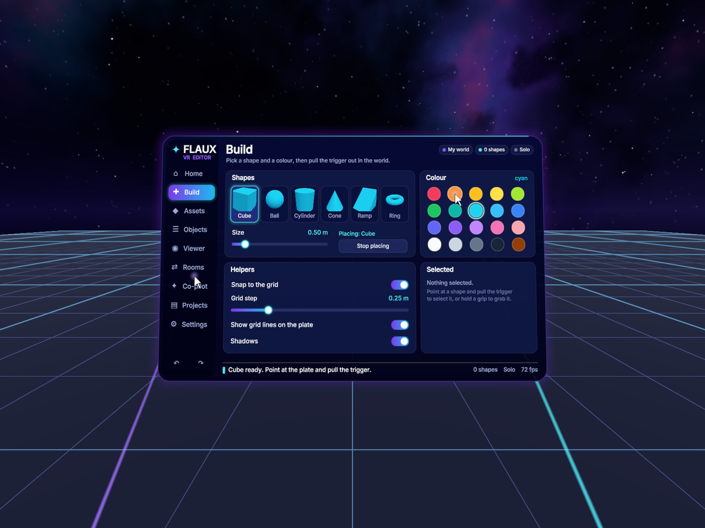
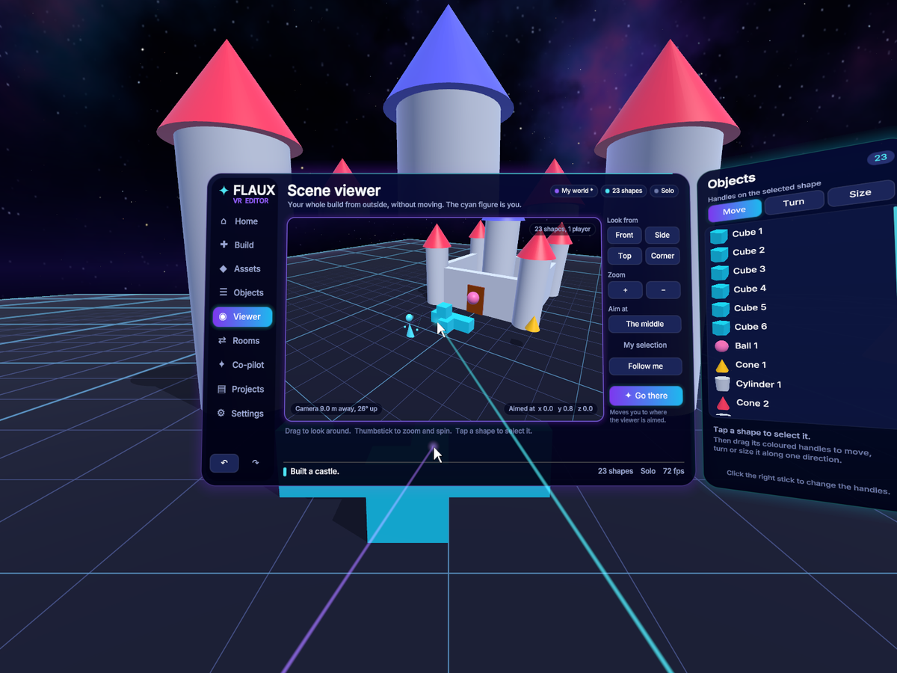

# Flaux VR

**Flaux VR is a 3D editor you use inside a Meta Quest headset.** You stand on a
plate floating among the stars, pick shapes from a panel, and build with your
hands.



It's a native app (C, OpenGL ES 3 and OpenXR): no game engine, no Java.

## Put it on your headset

1. Build `build/FlauxVR.apk` (see [Build it](#build-it)), or get one from someone who has.
2. Turn on **developer mode** for your headset (in the Meta Horizon phone app).
3. Plug the headset into a computer and install it:

   ```
   adb install -r FlauxVR.apk
   ```

   (Or drag the file into SideQuest or Meta Quest Developer Hub.)
4. In the headset, open **Library**, choose **Unknown sources**, and start **Flaux VR**.

> If an older Flaux VR is already installed, remove it first
> (`adb uninstall com.xobnvr.flaux`): Android won't put an app signed with
> one key on top of the same app signed with another.

It needs the two Touch controllers. Hand tracking isn't supported yet.

### If it won't start

Flaux VR writes down what it's doing as it starts, in
`Android/data/com.xobnvr.flaux/files/log.txt` on the headset. Plug the headset
into a computer, allow file access in the headset, and open that file (or run
`adb logcat -s FlauxVR`). The last line says how far it got; if it crashed,
the file ends with `CRASH` and where. If there's no `log.txt` at all, the app
never got as far as running.

## Controls

| Do this | To |
|---|---|
| **Trigger** | click the panel, select a shape, place a shape |
| **Grip** | grab a shape and move it; grab the panel to move it |
| **Both grips** | stretch the shape you're holding bigger or smaller |
| **Thumbstick while holding** | push it away, pull it in, spin it |
| **Left stick** | walk |
| **Right stick** | turn; push up or down to fly |
| **X** | bring the panel to you |
| **Y** (or the menu button) | hide or show the panel |
| **A** / **B** | undo / redo |

## The panel

| Tab | What it's for |
|---|---|
| **Home** | the controls, and what's in the scene |
| **Build** | pick a shape (cube, ball, cylinder, cone, ramp, ring), a colour and a size, then pull the trigger out in the world. Snap to a grid, show or hide grid lines and shadows. |
| **Objects** | every shape in a list. Rename, move, resize, turn, recolour, lock, copy or delete the one you pick. |
| **Viewer** | the **scene viewer**: a screen showing your whole build from outside. Drag to look around it, use the thumbstick to zoom, tap a shape to select it, and press **Go there** to jump to that spot. |
| **Rooms** | build together: one headset opens a room, others on the same Wi-Fi see it and join. |
| **Co-pilot** | type what you want ("a tower of 6 red cubes", "a ring of 12 balls", "a castle") and it's built in front of you. It runs on the headset, with no internet. |
| **Projects** | save, open and delete projects, and write your build as a Flaux program (`.flx`) to open in Flaux Studio. |
| **Settings** | how far away and how big the panel is, walking speed, turning, star brightness, buzz and sounds. |



Your work is saved by itself every few seconds and when you take the headset
off, so it's there next time. Projects are kept on the headset in
`Android/data/com.xobnvr.flaux/files/projects`, and exported Flaux programs in
`.../files/exports`.

## Build it

You need Linux, the Android NDK (r26 or newer) and an Android SDK with
`build-tools;34.0.0` and `platforms;android-34`:

```
ANDROID_NDK=/path/to/android-ndk-r26d ANDROID_SDK=/path/to/android-sdk ./build.sh
```

That makes `build/FlauxVR.apk`, signed with a debug key it creates in
`build/debug.keystore`. To sign with your own key, set `FLAUX_KEYSTORE` and
`FLAUX_KEYSTORE_PASS`. The OpenXR headers are downloaded from Maven Central
the first time (into `third_party/`). The OpenXR loader is the Khronos one, in
`prebuilt/arm64-v8a/`, next to a near-empty `classes.dex` (the app is all
native code).

There's no Gradle: `build.sh` is one C compiler call, then `aapt2`,
`zipalign` and `apksigner`.

## Test it without a headset

```
./test.sh
```

builds the same app for your computer, runs it off-screen with a pretend head
and pretend controllers (clicking tabs, placing and grabbing shapes, typing on
the keyboard), and saves a picture of every screen in `build/shots/`. It needs
`cc`, Mesa's EGL and OpenGL ES libraries, and Python with Pillow. It's built
with the address and undefined-behaviour sanitizers, so memory mistakes stop
the run.

`./test_xr.sh` goes further: it builds the headset's own OpenXR code
(`src/xr_main.c`) for your computer and runs it against the Monado OpenXR
runtime, so the session, the eye pictures and the controls are exercised for
real. It needs `libopenxr-dev`, `libopenxr1-monado` and `monado-service`.

To test rooms, run two copies:

```
./build/flauxvr_test assets build/shots host &
./build/flauxvr_test assets build/shots join 127.0.0.1
```

## The files

| File | What's in it |
|---|---|
| `src/fx.h` | the maths, and what each file offers the others |
| `src/gfx.c` | the world: stars, the plate, shapes, shadows, lasers |
| `src/ui.c` | the panel's drawing and widgets (rounded rectangles, text, buttons, sliders) |
| `src/screens.c` | the tabs and the keyboard |
| `src/editor.c` | pointing, placing, grabbing, moving around, saving |
| `src/scene.c` | the list of shapes, undo and redo, project files |
| `src/copilot.c` | the co-pilot's patterns |
| `src/net.c` | rooms |
| `src/xr_main.c` | the headset: Android, OpenGL ES, OpenXR, sound (and the same OpenXR code on a PC, for `test_xr.sh`) |
| `src/desktop_main.c` | the off-screen test rig |
| `tools/make_font.py` | makes the font (`assets/ui/font.bin` and `src/font_data.h`) from Inter and DejaVu Sans |
